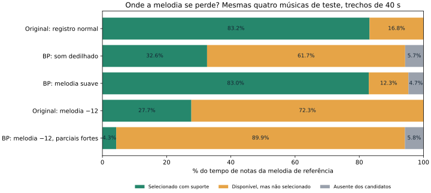

# Resolução melódica: candidatos disponíveis, oráculos e trajetórias

Pesquisa local de 12/11/2026. Foram lidos integralmente `PESQUISA_MELODIA.md`, `PESQUISA_RESULTADOS.md` e `PESQUISA_HARMONICA.md`. Esta fase reutiliza seus candidatos e controles, sem repetir MELODIA, Klapuri ou a transcrição dos contraexemplos.

## 1. Resposta à pergunta central

**Neste piloto com referência conhecida, a perda dominante de altura da melodia vem da seleção entre candidatos disponíveis, não da ausência da altura correta. Entretanto, os limites de ataques e finais da transcrição continuam sendo um problema importante.**

Nas quatro músicas de teste sintetizadas, a candidata da altura correta está disponível em aproximadamente 94–95% do tempo anotado. O arranjador atual preserva entre 4,3% e 83,0%, dependendo da condição. A diferença não é explicada apenas por notas ausentes.

Isso não prova que o mesmo diagnóstico domine todas as gravações reais do aplicativo. POP909 é um corpus de arranjos pop para piano; usamos síntese aditiva controlada e poucos timbres. MEGALOVANIA, ASGORE e as outras 32 gravações continuam sem referência musical alinhada.

O classificador próprio recupera parte da diferença no POP909, mas **falha nos contraexemplos anteriores e não deve ser promovido**. As evidências justificam melhorar a seleção e sua avaliação antes de substituir o Basic Pitch ou adotar uma arquitetura maior.



Na figura, a unidade é tempo de notas da referência, não porcentagem de duração da gravação. “Disponível, mas não selecionado” inclui candidatos da altura correta que a primeira voz deixa passar. Notas executadas em silêncios e notas erradas são avaliadas separadamente.

## 2. Dataset, isolamento e divisão

Fonte: [POP909, repositório dos autores](https://github.com/music-x-lab/POP909-Dataset), commit `d83e6edba6872a704f5d3b8b32f5cb540088dae6`. O repositório identifica MELODY como melodia principal, BRIDGE como submelodia e PIANO como acompanhamento. A licença declarada no repositório é MIT.

Primeiro foi consultado o inventário remoto. Os 909 MIDIs principais somam 11.283.951 bytes. Foram baixados somente **32 MIDIs principais, 401.393 bytes**, seu índice e metadados de batidas. Versões alternativas de uma mesma pasta não entraram no conjunto.

A divisão foi gravada antes de abrir eventos ou resultados. Semente `20261112`, agrupamento conservador por título normalizado, uma versão por obra:

| Uso | IDs POP909 |
| --- | --- |
| Treino, 16 | 764, 855, 774, 228, 908, 656, 072, 039, 347, 304, 575, 738, 825, 275, 507, 808 |
| Desenvolvimento, 8 | 134, 065, 389, 743, 003, 891, 386, 793 |
| Teste, 8 | 116, 489, 600, 531, 406, 514, 141, 835 |

O subconjunto acústico usa os primeiros oito IDs de treino e os primeiros quatro de desenvolvimento/teste, conforme declaração anterior às medições. São 16 obras e três condições por obra, totalizando **48 WAVs de 40 s: 32 minutos de áudio gerado**.

- `piano-equal`: todas as partes com o mesmo timbre aditivo de ataque e decaimento, inspirado em som dedilhado. Não é gravação nem SoundFont de piano.
- `soft-reed`: melodia com outro envelope/espectro e ganho relativo 0,28; acompanhamento mais forte.
- `low-bright`: melodia uma oitava abaixo, com terceiro harmônico intenso. A referência é transposta junto; não se compara com a oitava original.

O trecho começa oito segundos após a primeira nota global e dura 40 segundos, sem selecionar o trecho pela qualidade do resultado. Notas que atravessam o início são reatacadas em zero na síntese e na referência correspondente. Não há reverberação nem pedal acrescentado. Uma das obras de treino tem melodia ausente nesse trecho e fornece um caso legítimo de silêncio do alvo.

Também foram criadas as **48 condições simbólicas limpas dos mesmos trechos**, com as mesmas notas, transposição e limites temporais dos WAVs. Essas condições adicionais foram avaliadas após o congelamento e não foram acrescentadas ao treinamento.

Ao todo: 32 entradas simbólicas integrais + 48 transcrições + 48 contrapartidas simbólicas = **128 condições de entrada**. Cada uma foi arranjada com 1, 2, 3, 4, 6, 8 e 12 motores: **896 arranjos do baseline**. Isso não equivale a 896 obras independentes.

### Ocultação das pistas

O arranjador recebe apenas início, fim, MIDI e intensidade, sem nome de pista, instrumento, canal ou posição na lista original. Eventos das três partes são misturados e ordenados. As referências ficam em arquivos separados e são abertas pelo avaliador.

Na entrada simbólica limpa, a intensidade é uniformemente 0,65. Na síntese, são usados os velocities e ganhos declarados; na entrada transcrita, a intensidade é a ativação do Basic Pitch. Não se promove velocity MIDI a probabilidade acústica.

A referência MELODY original é preservada, inclusive pequenas sobreposições expressivas. Não foi convertida artificialmente em uma sequência monofônica perfeita para favorecer o arranjador ou os oráculos.

### Configuração do baseline

Cópia congelada do `score.mjs` atual: modo melodia, densidade alta, filtro 0,15, harmonia e condução ligadas, percussão e dobramentos desligados. Bends e mix desligados. A transcrição usa os mesmos thresholds altos atuais, 0,25/0,15, incluindo sua decodificação curta e união de fragmentos.

O SHA-256 do arranjador é `375fa91ad6ae11c9ddbea6aa312f17fce7a780fd4927b29a6ff7377a00f84436`. Não foi usado `continuous-v1`, rejeitado na fase anterior.

## 3. Métricas e três limites distintos

### Métricas temporais

Os intervalos são integrados pelas suas bordas, sem grade aproximada de 10 ms. Para cada altura, são unificados intervalos de uníssono antes da integração.

- **Cobertura/recall temporal:** segundos corretos de altura divididos pelos segundos de notas de MELODY.
- **Precisão temporal:** segundos corretos divididos pelos segundos de notas reproduzidas na primeira voz.
- **F1 temporal:** combinação dessas duas medidas.
- **Reprodução em silêncio:** duração executada quando nenhuma nota de MELODY está ativa, dividida pela duração desses silêncios.
- **Falsa sustentação:** excesso de fim em notas associadas por altura e ataque a uma referência, somando `max(0, fim_estimado − fim_referência)`. Não é a mesma medida que reprodução em silêncio.

Cobertura em qualquer motor e cobertura da primeira voz são separadas. A preservação de BRIDGE e PIANO é medida temporalmente em qualquer voz; isso não identifica qual instrumento físico teria produzido um uníssono.

### Métricas de eventos

`mir_eval==0.8.2`, associação máxima um a um:

- **F1 de notas:** mesma altura, ataque a até 50 ms e fim a até `max(50 ms, 20% da duração de referência)`.
- **F1 de ataques com altura:** mesma altura e tolerância de 50 ms, sem exigir fim correto.
- **F1 só de ataques:** ignora a altura; fica no JSON para não confundir ritmo com melodia.

Precisão e recall acompanham os F1s nos resultados. Uma nota fragmentada pode ter boa cobertura temporal e péssimo F1 de eventos. Silêncio do alvo não vira uma nota de referência inventada; casos sem MELODY não entram em médias de recall/F1 de melodia.

### Oráculo temporal

Verifica, para cada intervalo, quais alturas da referência estão presentes nos candidatos ativos. Não escolhe uma única linha e não resolve conflitos de simultaneidade. É um limite de **disponibilidade**, não uma partitura executável.

### Oráculo de cobertura com eventos inteiros

Programação dinâmica exata de intervalos ponderados: maximiza o tempo de altura correta e desempata pela menor duração incorreta. Só seleciona eventos inteiros disponíveis, sem mudar ataques, fins ou duração, e sem sobreposição.

### Oráculo de F1 de eventos inteiros

Otimização inteira mista com uma variável por correspondência elegível candidato/referência. Impõe associação um a um e no máximo um evento em cada clique de sobreposição. Maximiza a quantidade de matches; como só reproduz eventos associados, maximiza F1 nesse contrato estrito. Todas as otimizações terminaram com ótimo certificado.

**Cuidado com o significado de “teto”:** o baseline pode cortar eventos em outro ataque e fazer legato. Os oráculos de eventos inteiros não têm essas permissões; portanto, não são limites universais para qualquer arranjador que altere finais. Seu objetivo é medir a qualidade e a viabilidade dos eventos originais, sem repará-los. A disponibilidade temporal continua sendo uma medida diferente.

Os oráculos também foram calculados antes do filtro de intensidade. A decomposição distingue ausência na saída decodificada, perda pelo filtro e erro de seleção. Não se atribui automaticamente uma ausência à rede neural em si.

Uma medição adicional isolou a preparação de eventos: na entrada simbólica integral de teste, ela reduz a disponibilidade de 100% para 96,46%. Portanto, aproximadamente 3,54 pontos percentuais vêm de duração mínima/uníssonos/cortes na preparação, enquanto a maior parte da distância até os 58,12% da primeira voz permanece na seleção. Nas três condições BP de teste, a preparação não reduziu a disponibilidade temporal média além das perdas já presentes nos eventos.

## 4. Resultados no teste: entrada limpa e transcrita

Médias por música, sem misturar treino/desenvolvimento. As três condições acústicas repetem as mesmas quatro obras; não são doze obras independentes.

| Entrada, mesmo trecho quando indicado | Obras | Cobertura voz 1 | Disponibilidade temporal | Cobertura do oráculo de eventos inteiros | F1 de notas atual | F1 máximo de eventos inteiros |
| --- | --- | --- | --- | --- | --- | --- |
| Simbólico integral | 8 | 58,12% | 100% | 97,46% | 0,3666 | 0,9834 |
| Trecho limpo, registro normal | 4 | 83,20% | 100% | 96,37% | 0,5375 | 0,9766 |
| BP, `piano-equal` | 4 | 32,60% | 94,28% | 82,52% | 0,1037 | 0,4747 |
| BP, `soft-reed` | 4 | 83,00% | 95,31% | 83,73% | 0,2331 | 0,5344 |
| Trecho limpo, melodia −12 | 4 | 27,70% | 100% | 96,39% | 0,1778 | 0,9766 |
| BP, `low-bright` | 4 | 4,31% | 94,21% | 82,14% | 0,0092 | 0,5406 |

`piano-equal-symbolic` e `soft-reed-symbolic` têm as mesmas notas limpas, portanto o mesmo resultado no baseline. A condição grave já mostra um problema de prioridade melódica **antes** da transcrição. Na condição normal, as falsas detecções e os limites da transcrição alteram fortemente a seleção, apesar de a maioria das alturas continuar disponível.

### Decomposição da perda de altura

As três colunas abaixo somam 100% do tempo de notas da referência. Usam os candidatos decodificados antes do filtro da interface e a primeira voz do baseline.

| Condição BP | Ausente dos candidatos | Disponível, mas não selecionado | Selecionado com suporte nos candidatos |
| --- | --- | --- | --- |
| `piano-equal` | 5,72% | 61,69% | 32,59% |
| `soft-reed` | 4,70% | 12,34% | 82,97% |
| `low-bright` | 5,79% | 89,91% | 4,30% |

Uma pequena parte do tempo correto pode vir de legato fora do suporte original dos candidatos; ela é registrada separadamente. A tabela não obtém recuperação aparente sustentando uma nota durante todo o silêncio.

O diagnóstico de **seleção dominante vale para disponibilidade de altura neste ensaio**. Já o F1 máximo de eventos cai de 0,9766 nos trechos limpos para 0,4747–0,5406 nas transcrições. Assim, ataques, finais e conflitos entre eventos também limitam o resultado. Não se pode chamar os 94–95% de disponibilidade de “95% de transcrição correta”.

### Precisão, ataques e silêncios

| Entrada | Precisão temporal | Recall temporal | Precisão de notas | Recall de notas | F1 de ataques com altura | Fração do silêncio de MELODY indevidamente preenchida |
| --- | --- | --- | --- | --- | --- | --- |
| Trecho limpo normal | 40,72% | 83,20% | 46,38% | 70,50% | 0,6399 | 67,81% |
| BP `piano-equal` | 15,54% | 32,60% | 8,90% | 12,86% | 0,2541 | 90,53% |
| BP `soft-reed` | 34,50% | 83,00% | 20,02% | 29,68% | 0,5829 | 87,86% |
| BP `low-bright` | 2,59% | 4,31% | 0,78% | 1,11% | 0,0633 | 83,74% |

Falsas sustentações médias nesses três casos BP: 1,197 s, 3,060 s e 0,579 s por trecho. Esses números são definidos sobre notas associadas por ataque, não sobre todo o tempo errado. Os dados revelam outro defeito: a primeira voz frequentemente continua tocando acompanhamento quando a melodia anotada está em pausa.

### Preservação das outras partes sob orçamento

Simbólico integral, oito músicas de teste. Cobertura correta em **qualquer motor**:

| Motores | MELODY | BRIDGE | PIANO |
| --- | --- | --- | --- |
| 1 | 58,12% | 63,88% | 3,49% |
| 2 | 61,60% | 67,57% | 35,69% |
| 3 | 76,18% | 81,40% | 56,87% |
| 4 | 83,85% | 85,88% | 76,28% |
| 6 | 92,22% | 93,10% | 95,51% |
| 8 | 93,53% | 94,34% | 97,90% |
| 12 | 93,53% | 94,40% | 97,95% |

A primeira voz permanece igual entre esses orçamentos. Aumentar motores recupera notas em outras linhas, mas não corrige sua identidade melódica. Preparação de uníssonos, cortes e limites de duração ainda podem perder informação mesmo quando há motores suficientes.

## 5. Métodos externos: revisão, execução e impedimentos

### LStoM

[Artigo](https://archives.ismir.net/ismir2022/paper/000091.pdf) e [código](https://github.com/bytedance/midi_melody_extraction), commit `106f1d9a6e96f9e9d0ad9cbacb47f9ae17c60c72`. Licença declarada MIT.

O artigo propõe classificação de notas por biLSTM com altura, duração, distâncias das alturas simultâneas, posição no compasso e pertencimento à escala. Seus resultados publicados distinguem entrada quantizada e não quantizada; não são resultados locais desta fase.

**Não executado:** não há checkpoint nem YAML de normalização publicados no repositório inspecionado; a lista de releases está vazia. A inferência exige ambos. Dependências incluem PyTorch ~1.12.1, miditoolkit e music21 ~6.7.1. O código também usa `np.str`, removido do numpy atual, e deixa `notes` indefinido quando o pré-processamento está desligado. Nada disso foi apresentado como uma reprodução bem-sucedida.

Para Basic Pitch, duração em segundos não pode simplesmente ocupar o campo em batidas. Seriam necessários andamento, mapa de batidas, compasso e posição de início estimados sem usar a referência de teste. Um caminho a investigar é calcular características rítmicas com incerteza e preservar os tempos originais dos eventos, evitando quantização obrigatória. Isso exigiria validar a adaptação ou treinar novamente; não foi fingida uma execução do modelo original.

### Musical Voice Separation as Link Prediction — GMTT

[Artigo](https://www.ijcai.org/proceedings/2023/430), [código](https://github.com/manoskary/vocsep_ijcai2023), commit `82152a9591ba2759a556a6f9f52fd8eab771ca4a`. Licença declarada MIT.

O método aprende ligações entre notas em grafos heterogêneos, com restrições de trajetórias e associação linear opcional. Foi desenvolvido para notas quantizadas e vozes monofônicas; seus F1s publicados avaliam ligações, não o F1 de notas melódicas usado aqui.

**Não executado:** o caminho fornecido para pesos é o artifact W&B `vocsep/Voice Separation/model-1eii6k4w:v0`. O cliente retornou `UsageError: No API key configured`. Uma consulta GraphQL anônima ao projeto retornou HTTP 200 com `project: null`. Isso não permite distinguir projeto privado, indisponível ou removido; o checkpoint não foi obtido.

O código depende de PyTorch 1.12.1, torch_scatter 2.1.1, Lightning 1.5.10 e Partitura 1.2.1. Não foram instaladas essas dependências antigas sem os pesos. O próprio construtor de grafos compara ataques/finais em divisões simbólicas; ataques imperfeitos do BP alterariam relações de simultaneidade e sucessão. Seriam necessárias unidades métricas e uma política de tolerância ou quantização validadas. Não há comparação local de GMTT com `bestChain()`; a comparação de trajetórias medida abaixo pertence ao protótipo próprio.

### Aprendizado multitarefa de F0

[Artigo](https://arxiv.org/abs/1809.00381), [código e pesos](https://github.com/rabitt/multitask-f0), commit `b6e68490118c37b043cfeda51f9641edcb7b3c98`. Licença declarada MIT. O modelo gera saliências separadas para múltiplas fundamentais, melodia, baixo e voz cantada, a partir de HCQT.

**Executado localmente com pesos publicados.** Foi necessário portar as APIs antigas do Keras. O script executa o `get_model()` do autor, troca imports, preserva nomes de BatchNorm e usa `tf.squeeze`. Foram carregados e comparados exatamente os **132 tensores** publicados, verificando parâmetros das camadas. Inferência por blocos foi comparada com inferência integral em um controle: diferença máxima absoluta **zero**.

É uma inferência local de um port compatível, não reprodução do benchmark publicado: usamos TensorFlow 2.21.0, Keras 3.15.1 e librosa 1.0.1, enquanto o arquivo de pesos é do Keras 2.0.3. A frente HCQT moderna não foi demonstrada idêntica bit a bit à biblioteca de 2018.

Foram executados os 12 controles acústicos anteriores e prefixos de 16 s de MEGALOVANIA e ASGORE. Frequências seguem o áudio original; na fusão com candidatos normalizados de ASGORE, a consulta de frequência considera −38 cents. Não se confundiram esses domínios.

O head de melodia, com o threshold publicado de 0,4, recuperou 100% do alvo no controle de harmônicos ricos e 97,1% no de ataques diferentes, mas 0% nos controles de senoide e fundamental ausente e apenas 4,5% na melodia aguda suave F. Esse é recall temporal com vozeamento exigido, não F1 de eventos nem exatamente o RPA publicado.

Nos quatro conflitos de MEGALOVANIA, o suporte médio do head melódico a 55 foi 0,633 / 0,633 / 0,599 / 0,603, contra 0,245 / 0,241 / 0,191 / 0,197 para 74. Há evidência complementar útil, mas esses valores não são probabilidades calibradas de verdade e não constituem gabarito musical.

#### Fusão aditiva, sem veto

Foi criada uma cópia do baseline com `prioridade = prioridade_original + 4 × suporte_melódico_médio`. Alpha 0 e 1 foram declarados como ablação, sem escolher o melhor em função dos controles. Nenhuma candidata foi acrescentada ou removida pelo guia.

Nos controles já conhecidos, a fusão aumentou cobertura de 0 para 95,37% no caso de harmônicos ricos, de 0 para 100% no caso C e de 60 para 100% em F. A senoide permaneceu em 89,09%, apesar do head sozinho se abster. Nos casos de fundamental ausente, continuou em 0%: o arranjador não pode selecionar uma altura sem candidata.

Esses controles já haviam sido inspecionados e não servem como nova validação independente da fusão. Foi também executada a avaliação fixa nos 12 WAVs das quatro obras POP909 reservadas para teste, sem retreinar o modelo nem ajustar o peso. A variante de fusão foi acrescentada como experimento exploratório após a análise do protótipo; não se apresenta essa extensão como uma comparação cega pré-registrada. O peso foi mantido fixo em todas as obras e condições.

| Entrada BP, quatro obras | Cobertura atual → com guia | F1 de notas atual → com guia | F1 de ataques atual → com guia |
| --- | --- | --- | --- |
| `piano-equal` | 32,60 → 56,51% | 0,1037 → 0,1574 | 0,2541 → 0,4120 |
| `soft-reed` | 83,00 → 84,16% | 0,2331 → 0,2372 | 0,5829 → 0,5860 |
| `low-bright` | 4,31 → 17,82% | 0,0092 → 0,0484 | 0,0633 → 0,1438 |

O baseline alpha=0 foi reproduzido exatamente nos 12 casos, conferindo todas as sequências contra os arquivos congelados. O guia oferece ganho neste piloto, porém não resolve a seleção: continua abaixo do oráculo e aumenta ligeiramente a reprodução indevida em silêncios. Em `piano-equal`, essa fração sobe de 90,53 para 91,75%. Seu custo também é maior. Não foi adotado como filtro obrigatório nem promovido ao aplicativo.

## 6. Protótipo próprio: existência, papel melódico e afinidade

Foi implementada uma função manual e um baseline XGBoost com três pontuações separadas:

1. **Existência:** se pelo menos metade da duração de uma candidata tem suporte da mesma altura em qualquer parte de referência.
2. **Papel melódico:** classificação treinada apenas nas candidatas com existência anotada, distinguindo MELODY do restante.
3. **Afinidade:** se duas candidatas podem ser sucessoras na trajetória MELODY, incluindo fragmentos da mesma nota. Não é uma identidade instrumental de todas as vozes.

Há 23 características: ativação de nota e ataque, estabilidade do contorno, duração, altura, posição relativa, vizinhas, densidade de ataques, suporte de fundamental, distâncias temporais e frequência de repetição de altura/duração. Relações harmônicas são características; não são exclusões. Essa contagem de repetição não equivale a detectar motivos musicais completos. Não há embedding tímbrico nem separação de fontes.

Treino: **35.956 candidatas**, das quais 29.450 têm suporte de existência e 6.178 pertencem à melodia entre as existentes; **52.409 pares**, com 6.113 positivos. São 16 entradas limpas integrais e 24 transcrições BP reais de oito obras sintetizadas. O modelo não foi treinado apenas com partituras perfeitas.

Os modelos de existência e papel usam 220 árvores, profundidade 3, taxa 0,05. Afinidade usa 120 árvores, profundidade 2. Treino em CPU, duas threads e semente fixa. Pesos por condição evitam que uma faixa longa domine simplesmente pela quantidade de notas.

A seleção é uma DP sobre eventos, com pontuação de existência × papel, menos um piso e custo de ligação. Pode interromper uma nota em outro ataque disponível, como o baseline; não estende os eventos para preencher pausas. Mantém as hipóteses concorrentes como entrada. Usa até 64 predecessoras elegíveis, com contexto temporal e notas longas ainda ativas.

Piso e peso de ligação foram escolhidos apenas no desenvolvimento: 0,20 e 0,03 para ambos os métodos. A configuração e os modelos foram congelados antes de abrir métricas de teste. As ablações sem afinidade e sem existência não foram reajustadas no teste.

### Resultados do protótipo no teste

| Entrada | Cobertura atual → XGBoost | F1 de notas atual → XGBoost | F1 de ataques atual → XGBoost |
| --- | --- | --- | --- |
| Simbólico integral, 8 obras | 58,12 → 68,02% | 0,3666 → 0,5741 | 0,5280 → 0,6366 |
| BP `piano-equal`, 4 obras | 32,60 → 46,35% | 0,1037 → 0,2213 | 0,2541 → 0,4775 |
| BP `soft-reed`, 4 obras | 83,00 → 76,26% | 0,2331 → 0,3240 | 0,5829 → 0,6077 |
| BP `low-bright`, 4 obras | 4,31 → 55,49% | 0,0092 → 0,2671 | 0,0633 → 0,4865 |

No caso suave, o recall temporal cai enquanto precisão e F1 melhoram. Portanto, não foi declarada melhoria por aumento de cobertura isolado. A função manual tem resultados mistos e não acompanha a recuperação da melodia grave obtida pelo classificador.

Há intervalos bootstrap descritivos por obra no JSON, com 2.000 reamostragens e semente fixa. Quatro obras acústicas são poucas; esses intervalos não demonstram generalização a gravações ou timbres inéditos.

### A afinidade aprendida justificou maior complexidade?

Não neste protótipo. Retirar seu custo aumentou a cobertura BP de 46,35 para 56,18% no som dedilhado e de 55,49 para 59,10% na condição grave. Os F1s também não mostram benefício consistente. Em entrada limpa integral, há pequena vantagem de F1 com afinidade, mas isso não basta para recomendar um modelo sequencial maior ou um grafo neural.

Isso é uma ablação do nosso classificador de pares, não uma refutação do GMTT publicado. O classificador não modela simultaneamente as identidades das outras vozes.

## 7. Contraexemplos, regressões e gravações existentes

As 144 entradas simbólicas e os 12 conjuntos de candidatas BP foram reutilizados, sem nova transcrição. A medição acrescenta o novo resolvedor e métricas que não existiam nos resultados anteriores. Também foram acrescentados nove cenários de cruzamento de vozes e pausas reais, em três registros e três durações.

| Família | Atual | XGBoost: cobertura do alvo |
| --- | --- | --- |
| Sombras harmônicas com variação temporal, 36 | 1,04% | 17,71% |
| Melodia aguda suave sobre acordes, 36 | 95,14% | **0%** |
| Voz aguda divergente, 36 | 100% | **0%** |
| Cruzamentos e pausas, 9 | 44,44% | **4,94%** |
| Controle acústico de senoide | 89,09% | **0%** |
| Controle acústico F, melodia suave | 60% | **20%** |

O resultado refuta a generalização desta versão do classificador. Características importantes aprendidas incluem distância da nota superior, percentil global e altura absoluta; essas correlações do POP909 não são identidades musicais universais. As condições de síntese compartilhadas entre treino e teste também limitam a evidência positiva. Não foi acrescentado fallback ou recalibrado o piso depois de olhar esses erros.

O controle D e as vozes paralelas sem alvo único continuam marcados como ambíguos, sem forçar uma classificação de melodia correta. Os controles de fundamental ausente continuam distinguindo falta de candidata de erro do seletor.

O protótipo congelado foi aplicado às 34 faixas existentes, incluindo MEGALOVANIA e ASGORE. Só essas duas tinham os mapas BP brutos necessários para todas as características acústicas; nas demais, a ausência foi marcada e constitui outra mudança de domínio. Foram preservadas as sequências e tempos. **Não foram inventadas métricas de fidelidade dessas gravações.** Não se aprovou o método por corrigir ou mudar os quatro conflitos 55/74.

## 8. Limitações e decisão de arquitetura

- Há forte evidência local de uma lacuna recuperável na seleção, inclusive com entrada simbólica perfeita. Não é necessário resolver toda ambiguidade harmônica para demonstrar essa lacuna.
- Disponibilidade de altura e eventos corretos são problemas diferentes. A transcrição ainda perde ataques/finais; a média de disponibilidade não resume sua qualidade.
- O modelo de papel aprende convenções de um corpus. Não reconhece universalmente qual linha um ouvinte consideraria principal, nem identifica instrumentos por timbre.
- O classificador melhora dentro do domínio testado, mas falha fora dele. Não há justificativa para colocá-lo no aplicativo.
- A afinidade local aprendida não trouxe ganho consistente. Não há evidência suficiente para saltar diretamente para uma arquitetura sequencial ou GNN maior.
- A amostra acústica testa músicas novas, mas reutiliza três famílias sintéticas de timbre. Não há validação perceptiva humana nem generalização demonstrada para misturas reais.
- A pista PIANO é polifônica. Não foi inventada uma divisão monofônica verdadeira para treinar identidade de todas as suas vozes.

**Decisão:** manter o Basic Pitch e a produção atuais. A próxima arquitetura experimental deve separar disponibilidade/acústica, papel melódico e ligação entre eventos, com possibilidade explícita de pausa e incerteza. A prioridade de pesquisa é tornar essa seleção robusta em dados diversos e reparar/representar os limites dos eventos; não substituir todo o transcritor com base no riff de uma música.

Antes de um novo modelo maior: ampliar treino com transcrições reais de sínteses variadas, solos, melodias em todos os registros, cruzamentos e silêncios; validar calibração e ablações; reservar novas obras/timbres ainda não examinados. Os testes desta fase permanecem como evidência publicada localmente e não devem virar um conjunto de ajuste oculto.

## 9. Tempos, memória e reprodução

Uma passagem local, CPU, sem GPU. Houve processos concorrentes; são tempos observados, não um benchmark controlado de latência. RSS é pico cumulativo do processo Linux, não memória adicional exclusiva de cada chamada.

| Etapa | Medição local |
| --- | --- |
| Basic Pitch, 48 WAVs / 1.920 s de áudio | inferência 24,36 s; decode 7,99 s; pico 392,1 MiB |
| Baseline, todos os orçamentos | média 5,93 ms por arranjo; N=1: 3,50 ms |
| Oráculo MILP de eventos | soma 5,90 s nas 128 condições; todos ótimos; processo até 121,6 MiB |
| Treino dos três XGBoost | fit 1,12 s; preparação, desenvolvimento e seleção completos 44,85 s; pico 360,2 MiB |
| Protótipo: características + quatro variantes | média 0,358 s por condição avaliada; pico 178,4 MiB |
| Multitarefa: controles de 2,7–2,8 s | aproximadamente 2 s de inferência por controle |
| Multitarefa: prefixos de 16 s | 12,26–12,60 s de inferência; processo até 1.579,3 MiB |
| Multitarefa: WAVs POP909 de 40 s | aproximadamente 31–39 s de inferência por WAV; processo até 1.592,8 MiB |

Na primeira condição POP909 do modelo multitarefa, as saídas salvas foram reaproveitadas após corrigir a leitura do quarto campo da referência; seu tempo de inferência não havia sido persistido e permanece `null`, sem valor inventado. Os outros tempos foram registrados normalmente.

### Artefatos

Run principal: `downloads/research/resolution-20261112/`.

- `protocol.json`, `dataset.json`: divisão anterior aos resultados, versões e hashes dos MIDIs.
- `candidates/`, `reference/`: entradas sem identidade e referências separadas.
- `audio/`, `raw/`: WAVs gerados e mapas BP preservados.
- `arrangements/`, `evaluation/`, `decomposition.json`: baseline, oráculos e decomposição antes/depois do filtro.
- `frozen-model.json`, `models/`, `prototype/`: configuração congelada, pesos e resultados próprios.
- `stress/`, `existing/`: contraexemplos e 34 gravações sem gabarito.
- `multitask/`, `multitask-validation/`, `multitask-pop909/`, `multitask-guide-pop909/`: saídas e ablações do modelo externo.

[Resumo estruturado e hashes](research/resolution/summary.json). Resultados completos e entradas congeladas estão também em JSON comprimido em `research/resolution/`; os três modelos próprios estão em `research/resolution/models/`. WAVs e mapas extensos permanecem no run local.

### Comandos principais

Use um diretório novo e preserve a ordem: as contrapartidas simbólicas dos trechos entram **depois do treino**, como aconteceu nesta execução.

```bash
uv pip install --python .venv/bin/python --target /tmp/motor-resolution-deps \
  --no-deps xgboost-cpu==3.4.1 pypdf==7.0.1

./run.sh scripts/research-resolution-external.py
./run.sh scripts/research-resolution-prepare.py downloads/research/resolution-replay
./run.sh scripts/research-resolution-transcribe.py downloads/research/resolution-replay
node scripts/research-resolution-baseline.mjs downloads/research/resolution-replay
./run.sh scripts/research-resolution-evaluate.py downloads/research/resolution-replay
./run.sh scripts/research-resolution-train.py downloads/research/resolution-replay

# Somente agora abrir teste; o avaliador exige o arquivo de congelamento.
./run.sh scripts/research-resolution-matched.py downloads/research/resolution-replay
node scripts/research-resolution-baseline.mjs downloads/research/resolution-replay
./run.sh scripts/research-resolution-evaluate.py downloads/research/resolution-replay \
  --splits train development test
./run.sh scripts/research-resolution-infer.py downloads/research/resolution-replay
./run.sh scripts/research-resolution-decompose.py downloads/research/resolution-replay
./run.sh scripts/research-resolution-preparation.py downloads/research/resolution-replay

./run.sh scripts/research-resolution-stress.py downloads/research/resolution-replay
./run.sh scripts/research-resolution-existing.py downloads/research/resolution-replay
./run.sh -m unittest discover -s tests -p test_research_resolution.py
```

Os dois últimos ensaios reutilizam os artefatos das fases anteriores, cujos caminhos estão explícitos nos scripts. Não baixam áudios novos nem criam referências para as gravações reais.

Para o modelo multitarefa, use um ambiente separado. O checkout completo original inclui saídas antigas grandes; uma reprodução pode baixar só `deepsalience/` e `experiment_output/multitask_base_experiment/` do commit registrado, em vez de todo o histórico/saídas.

```bash
git clone --filter=blob:none --no-checkout https://github.com/rabitt/multitask-f0.git \
  downloads/research/resolution-source-metadata/multitask-f0
git -C downloads/research/resolution-source-metadata/multitask-f0 sparse-checkout set \
  deepsalience experiment_output/multitask_base_experiment
git -C downloads/research/resolution-source-metadata/multitask-f0 checkout \
  b6e68490118c37b043cfeda51f9641edcb7b3c98

uv venv /tmp/motor-resolution-tf --python .venv/bin/python
uv pip install --python /tmp/motor-resolution-tf/bin/python \
  tensorflow-cpu==2.21.0 keras==3.15.1 librosa==1.0.1 h5py==3.14.0

# ./run.sh fornece as bibliotecas compartilhadas exigidas pelo ambiente NixOS.
./run.sh -c 'import subprocess; subprocess.run([
  "/tmp/motor-resolution-tf/bin/python", "scripts/research-resolution-multitask.py",
  "downloads/research/resolution-replay", "--repo",
  "downloads/research/resolution-source-metadata/multitask-f0"], check=True)'

./run.sh scripts/research-resolution-multitask-guide.py downloads/research/resolution-replay
```

O teste POP909 do modelo externo usa `--pop-split test --output <run>/multitask-pop909`; a fusão correspondente usa `research-resolution-multitask-guide.py <run> --pop`. Alpha e escala permanecem fixos. `--validate-chunk --only rich-harmonics --output <run>/multitask-validation` verifica o processamento em blocos.

As versões completas dos ambientes isolados estão em `research/resolution/research-environment.txt`, `tf-environment.txt` e `plot-environment.txt`. Para gerar os resultados portáteis e a figura depois dos ensaios:

```bash
uv pip install --python .venv/bin/python --target /tmp/motor-resolution-plot \
  --no-deps -r research/resolution/plot-environment.txt
./run.sh scripts/research-resolution-summary.py downloads/research/resolution-replay
./run.sh scripts/research-resolution-audit.py downloads/research/resolution-replay
```

Os seis testes novos verificam separação de métricas, solução exata versus busca exaustiva pequena, conflitos de monofonia, associação um a um e tolerâncias de eventos. O código do aplicativo não foi alterado; os hashes de `score.mjs` e `transcribe.py` continuam iguais aos snapshots.
