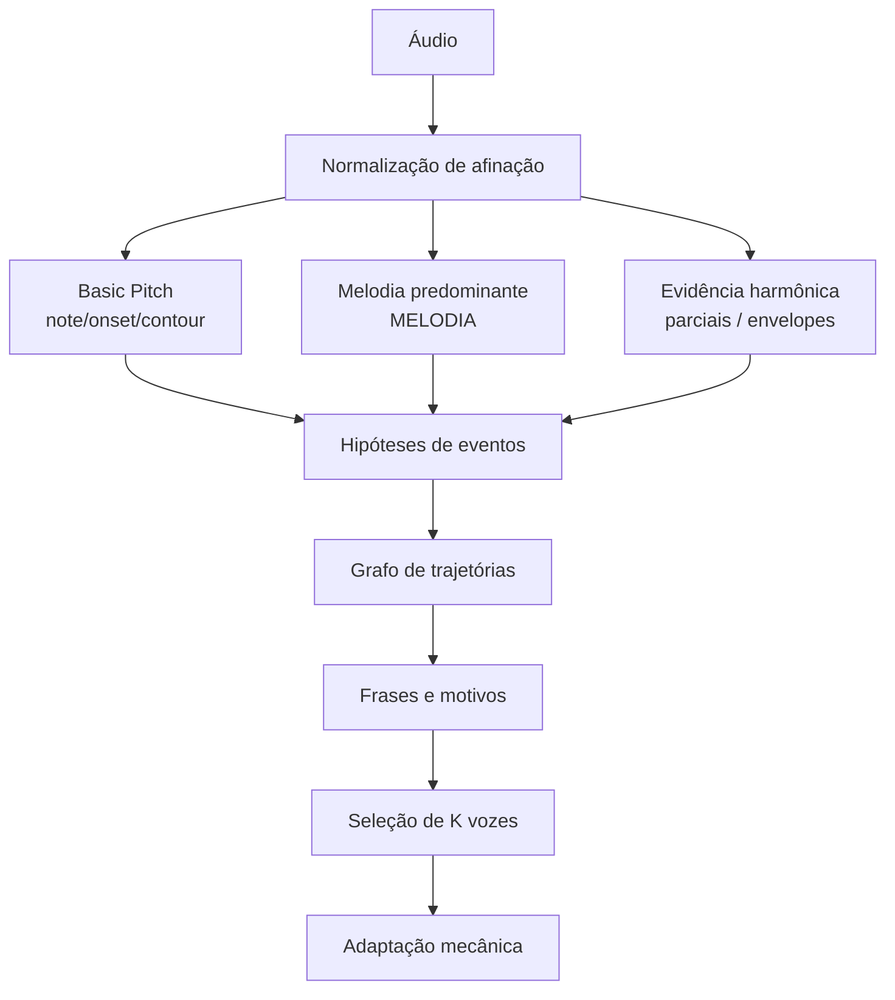

# Preservação da melodia ao reduzir áudio musical a poucas vozes monofônicas

## Resumo executivo

O documento anexado foi lido como fonte primária desta pesquisa. Ele define um problema mais específico do que “transcrever música”: a Sinfonia de Motores precisa transformar uma gravação completa em 1–12 linhas monofônicas preservando a informação que torna a faixa reconhecível — tema, ritmo e fundamento harmônico — e precisa separar erros introduzidos pela transcrição, pelo arranjo e pela reprodução. O dossiê também deixa explícito que ocupação das vozes, redução de pausas, semelhança espectral e número de candidatos não são, isoladamente, provas de melhoria musical. fileciteturn2file0

A evidência local mais forte está em MEGALOVANIA. Às 1,126 s, existem simultaneamente uma candidata MIDI (Musical Instrument Digital Interface) 55, intensidade 0,481, e uma candidata MIDI 74, intensidade 0,189. A diferença é 19 semitons. Em afinação temperada, o terceiro harmônico de MIDI 55 cai quase exatamente sobre MIDI 74; portanto, o candidato agudo pode ser um parcial forte da fundamental. O arranjador antigo selecionava MIDI 74 nesse ponto, apesar da fundamental mais forte estar disponível. O mesmo padrão reaparece por volta de 3,124 s, 5,13 s e 7,13 s. O experimento atual corrige parte das primeiras ocorrências, mas volta a selecionar MIDI 74 posteriormente. Isso localiza pelo menos uma classe de erro inequivocamente **de seleção**, sem excluir problemas concomitantes de limites de notas e ataques produzidos pelo transcritor. fileciteturn2file0

Em ASGORE, a evidência local aponta outro mecanismo: um deslocamento global estimado de −38 cents alterou profundamente a quantidade e a continuidade dos eventos produzidos pelo Basic Pitch. Na comparação histórica com o mesmo arranjador, os candidatos da densidade alta passaram de 2.222 para 3.850, a primeira voz de 393 para 447 eventos e as pausas internas maiores que 150 ms de 133 para 48. O documento corretamente adverte que essas métricas não demonstram que as notas recuperadas sejam corretas; mostram que o problema da entrada e da quantização de altura pode alterar fortemente a transcrição antes de qualquer decisão do arranjador. fileciteturn2file0

A literatura não sustenta substituir imediatamente o pipeline por um algoritmo inteiramente novo. Há componentes maduros para quase todas as subpartes: MELODIA constrói e seleciona contornos melódicos em áudio polifônico; pYIN usa candidatos múltiplos e HMM (Hidden Markov Model, modelo oculto de Markov)/Viterbi para F0 (frequência fundamental) monofônica; métodos multi-F0 de Klapuri e Deep Salience estimam evidência de fundamentais em misturas; Basic Pitch fornece transcrição polifônica leve e mapas intermediários; Demucs fornece separação de fontes; MT3 e YourMT3+ fornecem transcrição multi-instrumental; trabalhos de separação simbólica de vozes tratam notas como trajetórias em grafos; e trabalhos de redução de partitura já selecionam frases de acordo com importância e restrições do instrumento-alvo. citeturn293454search1turn293454search9turn664539search0turn904357search5turn338315search2turn904357search4turn904357search1turn904357search3turn236637search0turn236637search5

A recomendação é, portanto, progressiva. Primeiro, preservar os mapas brutos do Basic Pitch e acrescentar uma camada de **evidência**, em vez de substituir imediatamente as notas: estimativa de melodia predominante, probabilidade de independência de cada fundamental, ataques e relações harmônicas temporais. Em seguida, substituir a regra “uma cadeia ótima, remover, repetir” por uma seleção que opere sobre **trajetórias e frases**, mantendo hipóteses concorrentes quando houver ambiguidade. Separação de fontes e transcrição multi-instrumental devem entrar como baselines comparativos, não como premissas da solução. Só recomendo desenvolver o algoritmo híbrido completo se os experimentos demonstrarem simultaneamente que a transcrição contém a maior parte das notas corretas, que métodos de melodia existentes ainda confundem linhas harmônicas/acompanhamento e que o arranjador simples não preserva identidade, ataques e motivos sob baixo orçamento de vozes.

A arquitetura tecnicamente mais promissora é um **grafo de hipóteses musicais**, mas a primeira implementação deve ser uma versão muito menor: Basic Pitch + mapas brutos + MELODIA + atribuição harmônica temporal + programação dinâmica sobre trajetórias. Isso permite testar a hipótese principal com custo de CPU (Central Processing Unit, unidade central de processamento) baixo a moderado e sem treinamento novo.

## Diagnóstico do pipeline e dos erros observados

### O que o documento estabelece

O pipeline local usa Basic Pitch 0.4.0 via ONNX (Open Neural Network Exchange), áudio mono a 22.050 Hz, três conjuntos de limiares de detecção, correção conservadora de afinação global, decodificação em duas passagens, união de fragmentos e extração de curvas finas de altura. Depois, o JavaScript seleciona cadeias monofônicas por programação dinâmica, uma voz depois da outra. A primeira voz no modo de redução recebe um multiplicador que combina posição no registro local, intensidade relativa, continuidade e uma penalidade heurística de harmônicos. A reprodução usa senoides, sinos ou um modelo fenomenológico de motor, e o último motor pode ser reservado à percussão. fileciteturn2file0

O próprio dossiê já identifica uma fragilidade estrutural importante: depois de escolher a primeira cadeia, seus eventos saem da disputa e a próxima cadeia é otimizada sobre o restante. Isso não resolve conjuntamente o problema de “qual conjunto de K linhas explica melhor a estrutura musical”. Também existe perda explícita de identidade quando dois eventos da mesma altura e ataque são deduplicados ou quando um novo ataque da mesma altura encerra a cauda anterior independentemente da fonte. fileciteturn2file0

### Taxonomia operacional dos erros

A avaliação deve registrar o primeiro estágio no qual cada evento de referência diverge:

| Classe | Sinal observável | Responsável primário | Como distinguir |
|---|---|---|---|
| Nota ausente | Nenhuma hipótese compatível nos mapas/eventos | Transcrição | Procurar a nota primeiro no `contour`, `note` e `onset`, depois nos eventos decodificados |
| Evento perdido na decodificação | Evidência nos mapas, nenhum evento final | Decodificação/filtros | Comparar mapas brutos com as duas passagens e limiares |
| Harmônico tomado como nota | Candidato em razão aproximadamente inteira com uma fundamental, sem evidência clara de independência | Transcrição ou arranjo | Comparar parciais, envelopes, ataques, afinação e trajetórias |
| Erro de oitava | F0 correta em classe de altura, registro deslocado ±12, ±24... | Transcrição/rastreamento | Reportar RPA e RCA separadamente e classificar deslocamentos |
| Seleção incorreta | Nota correta existe no conjunto congelado, mas outra é escolhida | Arranjo | Avaliação “oracle”: teto da transcrição versus voz 1 |
| Fragmentação | Uma nota real vira vários eventos | Decodificação | Matching um-para-um por ataques/duração |
| Repetição apagada | Dois ataques reais viram uma sustentação | Decodificação/legato | Exigir evidência do segundo ataque |
| Troca de identidade | Uma frase pula entre motores/fontes sem necessidade | Arranjo | Métrica de continuidade da trajetória |
| Falsa sustentação | Evento invade pausa ou próximo ataque | Arranjo/reprodução | Medir offset e tempo excedente |
| Perda mecânica | Partitura correta, resposta física não atinge a nota/ataque | Reprodução | Comparar partitura ideal com frequência/envelope produzido |

Essa separação é compatível com a literatura de avaliação de melodia, que distingue presença/ausência da melodia, erro de altura absoluta e erro de classe de altura, e com a avaliação de transcrição baseada em correspondência temporal de eventos. `mir_eval` fornece implementações padronizadas dessas famílias de métricas. citeturn835584search8turn835584search9

### MEGALOVANIA: exemplo temporal de seleção harmônica

O trecho local contém:

| Intervalo | Fundamental/candidata baixa | Concorrente | Evidência local |
|---|---:|---:|---|
| 1,126–1,312 s | MIDI 55, 0,481 | MIDI 74, 0,189 até 1,265 s | Arranjador antigo escolheu 74 |
| 3,124–3,322 s | MIDI 55, 0,466 | MIDI 74, 0,190 até 3,264 s | Padrão praticamente repetido |
| 5,123–5,320 s | MIDI 55, 0,468 | MIDI 74, 0,207 a partir de 5,134 s | Experimento ainda escolhe 74 |
| 7,121–7,318 s | MIDI 55, 0,468 | MIDI 74, 0,208 a partir de 7,132 s | Experimento ainda escolhe 74 |

Esses valores são do documento, não da literatura. fileciteturn2file0

Para MIDI \(m\),

\[
f(m)=440\,2^{(m-69)/12}
\]

Logo, MIDI 55 está em aproximadamente 196 Hz. Seu terceiro harmônico está próximo de 588 Hz. MIDI 74 está em aproximadamente 587,3 Hz. A relação esperada em semitons para o terceiro harmônico é

\[
12\log_2(3)=19{,}01955
\]

ou seja, quase exatamente os 19 semitons observados.

Essa coincidência é uma **evidência de hipótese**, não uma classificação. A pesquisa psicoacústica mostra que harmonicidade e sincronismo de ataque influenciam a fusão perceptiva de componentes, e que diferenças de ataque podem fazer um componente deixar de contribuir para a altura percebida do complexo. Também sabemos que a altura de uma fundamental pode ser percebida mesmo quando não há energia na frequência fundamental propriamente dita. citeturn664539search2turn664539search5turn664539search7

A consequência algorítmica é importante: a penalidade de harmônicos não deveria ser uma função booleana de “diferença = 19 semitons e início parecido”. Ela deve estimar

\[
P(\text{independente}_j\mid i,j,\text{áudio})
\]

a partir de cinco grupos de evidência: proximidade à razão harmônica, cobertura temporal, ataque independente, coerência dos envelopes/parciais e continuidade independente antes/depois do par. **Inferência para o projeto:** um MIDI 74 que acompanha repetidamente a linha 55→53→55 com o mesmo padrão de ataques e sem estrutura espectral própria é mais plausivelmente um parcial; um MIDI 74 que continua numa trajetória diferente, com ataques ou modulações independentes, deve ser preservado como hipótese de outra voz. Essa inferência se apoia em mecanismos estabelecidos de agrupamento auditivo, mas a função probabilística específica precisa ser validada localmente. citeturn664539search4turn664539search5

### Ataques, limites e repetições

O trecho inicial também contém MIDI 62 de 0,058–0,441 s, enquanto o pYIN exploratório do documento indicou aproximadamente MIDI 50 até 0,221 s e MIDI 62 de 0,267–0,441 s. O próprio dossiê sugere que esse evento de MIDI 62 pode atravessar regiões acusticamente diferentes. Essa é precisamente uma situação em que um evento MIDI único não deve ser considerado a unidade elementar da análise. fileciteturn2file0

pYIN foi concebido para preservar candidatos alternativos por quadro e depois resolver um rastreamento monofônico com HMM/Viterbi. O artigo demonstra melhoria de precisão e recall sobre o YIN original em seu contexto de F0 monofônica, mas não demonstra que sua saída em uma mistura musical densa seja a melodia principal. citeturn293454search9 **Inferência:** a lição transferível para a Sinfonia de Motores é conservar alternativas até a etapa temporal, não substituir o Basic Pitch por pYIN aplicado cegamente à mixagem.

Para notas repetidas, duas hipóteses precisam coexistir quando os dados permitirem:

\[
H_1=[55,\;t_0,t_2]
\]

\[
H_2=[55,\;t_0,t_1]\;+\;[55,\;t_1,t_2]
\]

A escolha entre elas deve receber evidência do mapa de ataque do Basic Pitch, fluxo espectral, reinício de envelope e estrutura rítmica. O Basic Pitch atual pode salvar seus outputs brutos em NPZ (NumPy Zip), e sua documentação confirma que o modelo gera saídas intermediárias além do MIDI final. O próprio repositório recomenda registrar a versão do código porque o sistema evoluiu desde o artigo original. citeturn338315search2

### ASGORE: afinação e continuidade

O documento registra −38 cents e melhora grande após compensar a entrada da rede. Essa observação deve ser tratada como uma propriedade empírica daquela gravação e versão do pipeline, não como “ASGORE está afinado em −38 cents” em sentido absoluto. fileciteturn2file0

O experimento correto agora é uma curva controlada de sensibilidade:

\[
d\in\{-50,-38,-25,-12,0,+12,+25,+38,+50\}\text{ cents}
\]

Para cada \(d\), medir primeiro o próprio transcritor contra referência alinhada; só depois o arranjo. O resultado desejado seria observar se existe uma região de máximo de F1 de notas/ataques e se ela coincide aproximadamente com o desvio estimado. Caso a melhora apareça somente em ocupação/continuidade, a hipótese de “afinação recuperou a melodia” não estará demonstrada.

### Reprodução mecânica

O documento registra 900 RPM (rotações por minuto), 200 passos/revolução, aceleração máxima de 30.000 RPM/s, constante de resposta de 8 ms, simulação a 250 Hz e ressonância em 700 Hz, mas também afirma explicitamente que esse é um modelo fenomenológico, ainda sem protótipo físico calibrado. fileciteturn2file0

Portanto a avaliação mecânica deve vir **depois** da partitura ideal. Para cada evento, registrar `target_pitch`, `target_onset`, `target_offset`, `achieved_pitch(t)` e envelope. Métricas relevantes são atraso do ataque, tempo para entrar em ±50 cents, fração da nota dentro dessa faixa, erro de offset e sucesso de rearticulação de notas repetidas. Essa camada pode explicar por que uma linha MIDI correta deixa de soar reconhecível, mas não deve retroagir e mascarar erros de seleção durante a investigação.

## Evidência externa e comparação dos métodos

### O que cada método demonstra

| Método | O que a fonte original/oficial demonstra | Limitação para este projeto | CPU/GPU e maturidade |
|---|---|---|---|
| MELODIA | Agrupa candidatos em contornos contínuos e usa características desses contornos para detectar vozeamento, minimizar erros de oitava e selecionar a melodia predominante em áudio polifônico. citeturn293454search1turn338315search0 | Uma “melodia predominante” pode ser diferente do tema desejado; não resolve por si só ataques MIDI ou múltiplas vozes | Implementação madura em Essentia; algoritmo clássico, sem GPU obrigatória. A documentação atual recomenda `EqualLoudness` e expõe F0 + confiança. citeturn338315search0 |
| pYIN | Gera múltiplos candidatos probabilísticos de F0 e os rastreia com HMM/Viterbi; os autores mostram ganhos sobre YIN com baixo custo adicional no domínio monofônico. citeturn293454search9 | Misturas densas violam sua hipótese principal; pode seguir baixo ou fonte errada | CPU, baixo custo; excelente como verificador após separação ou em regiões quase monofônicas |
| CREPE | Rede convolucional monofônica diretamente sobre waveform; autores/repositório reportam desempenho forte contra trackers tradicionais no domínio avaliado. citeturn293454search5turn293454search4 | Também é monofônico; TensorFlow adiciona dependência pesada em comparação com pYIN | Pode rodar em CPU, mas rede neural adiciona custo; não há razão para colocá-lo antes de uma separação de fonte neste projeto |
| Klapuri multi-F0 | Calcula saliência de F0 por soma ponderada de amplitudes harmônicas e apresenta variantes direta, iterativa e com cancelamento para áudio polifônico. citeturn664539search0turn664539search9 | Saliência harmônica não equivale a importância melódica; cancelamento incorreto pode apagar fontes legítimas | Método clássico e relativamente leve; adequado como evidência acústica auxiliar |
| Deep Salience | Rede totalmente convolucional aprende representação de saliência de F0 e demonstra utilidade em multi-F0 e rastreamento de melodia em áudio polifônico. citeturn904357search5turn904357search9 | Outro modelo neural além do Basic Pitch pode duplicar informação e aumentar dependências | Pesos/código existem; custo superior à heurística espectral e precisa ser medido |
| Basic Pitch | Transcrição instrument-agnostic polifônica leve, com notas e pitch bends; documentação ressalta que funciona melhor com um instrumento de cada vez e permite salvar saídas brutas. citeturn293454search6turn338315search2 | Mistura completa de instrumentos e harmônicos ricos é precisamente um cenário difícil; não informa função musical | Já integrado, Apache 2.0, CPU viável e baixo custo relativo. citeturn338315search1 |
| Demucs v4 | Separa voz, baixo, bateria e `other`; versão experimental de seis fontes acrescenta guitarra/piano. Repositório informa artefatos importantes no piano. citeturn904357search4 | Tema e acompanhamento podem cair juntos em `other`; vazamento pode duplicar ataques/notas | MIT; suporta `-d cpu`. O repositório estima aproximadamente 1,5× a duração da faixa em CPU para Demucs, tornando 3 min ≈ 4,5 min como ordem de grandeza oficial, não benchmark do seu hardware. citeturn338315search3 |
| MT3 | Transformer unificado transcreve combinações de instrumentos e mostrou ganhos especialmente em instrumentos de poucos dados. citeturn904357search1turn904357search10 | Ecossistema T5X e modelo maior; instrumento identificado não implica “melodia principal” | Repositório oferece checkpoints, mas é uma alternativa pesada para baseline, não primeira escolha CPU. citeturn904357search0 |
| YourMT3+ | Estende MT3 com atenção hierárquica, mixture-of-experts e treinamento com anotações incompletas; reporta resultados competitivos em dez bases e também limitações em pop real. citeturn904357search3turn904357academia8 | Complexidade alta; ausência de benchmark CPU oficial útil para seu caso impede estimativa confiável | Código reprodutível; repositório atual usa GPL-3.0. citeturn832463view0 |
| Separação de vozes por grafo | Trata notas simbólicas como nós e prevê links entre notas consecutivas da mesma trajetória; inclui regularização para no máximo um predecessor/sucessor e suporta cruzamentos/overlaps. citeturn236637search0turn236637search1 | Parte de notas já fornecidas; não resolve diretamente candidatos harmônicos falsos nem notas ausentes | Conceito altamente relevante ao arranjo; o modelo publicado usa aprendizado, mas a estrutura de grafo pode ser adaptada com custos manuais |
| SIA/SIATEC | Encontra padrões repetidos em representações multidimensionais de música, inclusive polifônicos e com lacunas. citeturn236637search2turn236637search3 | Complexidade pode ser alta e repetição pode reforçar acompanhamento/harmônicos | Melhor como evidência posterior de estrutura, não primeira etapa |
| Score reduction por frases | Analisa funções, identifica frases, atribui importância e seleciona frases sob restrições de tocabilidade; trabalho posterior formaliza a redução como problema de otimização. citeturn236637search4turn236637search5 | Assume partitura simbólica significativamente mais limpa que uma AMT real | Precedente direto para a ideia de “preservar frases importantes sob orçamento de execução” |

A principal conclusão dessa comparação é que já existe suporte publicado para os blocos individuais. A lacuna específica da Sinfonia de Motores está em **combinar uma transcrição incerta, relações harmônicas ambíguas, função melódica, estrutura de frase e restrição a K trajetórias monofônicas**. Nenhuma fonte acima demonstra, sozinha, essa combinação na condição de áudio completo → 1–12 motores.

MELODIA é particularmente adequado como **feature**, não como substituto direto da transcrição. A implementação oficial em Essentia produz F0 e confiança por quadro, usa 10 cents de resolução de saliência por padrão, considera até 20 harmônicos e possui parâmetros explícitos de continuidade temporal e de altura. citeturn338315search0 Isso oferece uma evidência independente do mecanismo de prioridade atual. A primeira pergunta experimental deve ser simples: “quando MIDI 55 e 74 competem em MEGALOVANIA, onde está o contorno do MELODIA e com qual confiança?”.

Deep Salience oferece uma representação mais geral de multi-F0, mas o Basic Pitch já calcula representações de nota, ataque e contorno. Antes de adicionar outra rede, vale medir quanto da informação necessária já está presente nesses mapas brutos. O repositório oficial do Basic Pitch expõe explicitamente a opção de salvar model outputs. citeturn338315search2

A literatura de agrupamento auditivo sustenta outra decisão: onset synchrony, harmonicidade, timbre e modulações coerentes são sinais complementares para decidir se componentes pertencem ao mesmo objeto sonoro. citeturn664539search5turn664539search8 **Inferência:** a heurística atual de harmônicos deve evoluir de uma penalidade baseada principalmente em intervalos MIDI e coincidência temporal para uma estimativa de independência baseada em múltiplas pistas.

## Arquiteturas candidatas e recomendação



### Comparação das três finalistas

| Arquitetura | Representação | Harmônicos/oitavas | Ataques e repetições | Distribuição de vozes | Custo CPU esperado | Risco |
|---|---|---|---|---|---|---|
| **A — Guia melódico sobre Basic Pitch** | Eventos atuais + mapas brutos + F0/confiança do MELODIA + score harmônico | Penalidade probabilística, sem apagar candidato | Onsets do Basic Pitch continuam sendo autoridade principal | DP (programação dinâmica) atual, mas com score enriquecido | **Baixo–moderado**; uma passagem Basic Pitch já existente + MELODIA + features espectrais locais | Pode continuar preso à seleção sequencial e às notas ausentes |
| **B — Frente orientada a fontes** | Stems Demucs ou eventos multi-instrumentais MT3/YourMT3+ | Confusão entre fontes cai; harmônicos dentro da mesma fonte permanecem | Separação pode introduzir vazamento/artefatos | Trajetórias por fonte, depois função musical | **Alto em CPU** para Demucs/Transformers; Demucs oficial sugere ~1,5× duração em CPU. citeturn338315search3 | Tema e acompanhamento no mesmo stem; latência e RAM maiores |
| **C — Grafo de hipóteses e frases** | Hipóteses concorrentes + relações acústicas + links de trajetória + frases | Mantém alternativas até decisão global; pode representar oitava legítima e parcial como hipóteses distintas | Segmentações alternativas competem explicitamente | Otimização conjunta ou hierárquica de K trajetórias | **Moderado se esparso**, potencialmente alto se todas as combinações forem mantidas | Explosão combinatória e função objetivo mal calibrada |

Minha recomendação é implementar **A primeiro, projetando os dados para permitir evolução até C**. Isso responde diretamente ao caso mais claro do dossiê: em MEGALOVANIA, a fundamental correta frequentemente já está presente. Não é necessário um novo transcritor para demonstrar ganho nesse erro. fileciteturn2file0

A arquitetura B deve ser um **baseline experimental obrigatório** porque testa uma hipótese diferente: talvez muitos erros posteriores sejam consequência da mistura acústica que o Basic Pitch instrument-agnostic não consegue desambiguar. O próprio Spotify informa que o Basic Pitch funciona melhor com um instrumento por vez, enquanto Demucs e transcritores multi-instrumentais foram construídos justamente para fornecer alguma separação/identidade. citeturn293454search6turn904357search4turn904357search1 Mas o custo e o vazamento tornam inadequado adotá-la antes de medir.

A arquitetura C é a candidata a contribuição própria. Ela se justifica somente se três condições aparecerem nos dados: o “oracle coverage” do Basic Pitch for alto, a arquitetura A não conseguir preservar frases/identidade mesmo com boa evidência melódica, e os erros restantes envolverem decisões acopladas — por exemplo, uma interpretação de harmônico muda quais trajetórias existem e, por consequência, quais frases são selecionáveis.

### Representação intermediária recomendada

```text
HypothesisNote {
    id
    start, end
    midi
    fine_pitch_curve

    bp_note_score
    bp_onset_score
    bp_contour_support

    melody_support
    independent_f0_support
    harmonic_parent_candidates[]

    source_embedding_or_id
    attack_evidence
    release_evidence

    segmentation_group
    provenance
}
```

Esses campos não devem ser chamados todos de “probabilidade”. Os scores do Basic Pitch, confiança do MELODIA, intensidade do evento e custos de continuidade têm calibrações diferentes. Até que exista calibração empírica, trate-os como **features normalizadas**, não como probabilidades intercambiáveis.

### Função objetivo

Para uma hipótese \(n_i\),

\[
U_i =
w_b B_i+
w_o O_i+
w_m M_i+
w_f F_i+
w_r R_i
-
w_h H_i
-
w_x X_i
\]

onde \(B_i\) é suporte da nota Basic Pitch, \(O_i\) suporte do ataque, \(M_i\) suporte melódico, \(F_i\) evidência de fundamental independente, \(R_i\) evidência estrutural/repetição, \(H_i\) explicabilidade como parcial de outra fonte e \(X_i\) custo físico/local.

Para ligar duas notas \(i\to j\),

\[
C(i,j)=
\lambda_p\rho(\Delta p)
+\lambda_t G(\Delta t)
+\lambda_s(1-S_{ij})
+\lambda_a A_{ij}
+\lambda_q Q_{ij}
\]

com custos de salto, lacuna, mudança de identidade/fonte, articulação e quebra de estrutura de frase.

A função de salto deve saturar. Uma possibilidade inicial:

\[
\rho(\Delta p)=\min(|\Delta p|/12,\,2)
\]

É uma hipótese de engenharia, não resultado publicado. O objetivo é impedir que um salto expressivo real seja proibitivamente caro.

Para K vozes, o passo final pode ser formulado como fluxo de custo mínimo quando todos os custos forem locais/aditivos. Se houver recompensas não aditivas por motivos, hipóteses mutuamente exclusivas complexas ou papéis de voz, usar programação inteira em trechos curtos como “oracle” e uma aproximação hierárquica para a faixa inteira.

### Custos e memória: o que pode e não pode ser afirmado

Não há acesso, nesta sessão, aos WAVs nem ao repositório em `/home/gaok1/Pessoal/motor-orchestra`; o anexo contém dados e código, mas não permite executar um benchmark completo fiel. fileciteturn2file0 Portanto, não apresento números fabricados.

| Componente | Tempo CPU utilizável hoje como referência | Memória | Status da estimativa |
|---|---:|---:|---|
| Basic Pitch | Já é o baseline local; README o descreve como leve, mas sem tempo padronizado suficiente para converter em segundos no seu hardware. citeturn293454search6 | A medir | **Medir localmente** |
| MELODIA | Sem benchmark oficial comparável encontrado nesta revisão | Esperada baixa/moderada | **Medir localmente** |
| Features harmônicas esparsas | Deve escalar aproximadamente com quadros × candidatos × harmônicos | Pode ser limitada por processamento em blocos | **Estimativa algorítmica** |
| Grafo esparso | \(O(ND)\) arestas se cada evento considerar até \(D\) sucessores | \(O(ND)\) | **Estimativa algorítmica** |
| Demucs | Repositório indica ordem de ~1,5× duração da música em CPU. citeturn338315search3 | Segmentação controla memória | **Número oficial, não medido localmente** |
| MT3 / YourMT3+ | Nenhum benchmark CPU local ou oficial suficientemente comparável foi encontrado | Modelos maiores | **Não estimar numericamente sem medir** |

Uma faixa de três minutos sob a estimativa publicada do Demucs seria da ordem de quatro minutos e meio de processamento em CPU. Isso é aceitável como baseline offline, mas provavelmente excessivo como dependência obrigatória se A produzir qualidade semelhante. citeturn338315search3

## Especificação do algoritmo candidato

O algoritmo provisório abaixo pode ser chamado de **PHR — Preservação Harmônica e de Ritmo**. A parte nova não é um novo estimador de F0; é o mecanismo que combina hipóteses existentes e estrutura musical antes de reduzir a K linhas.

```text
PHR(audio, K):

    # Transcrição e evidências brutas
    tuning = estimate_global_tuning(audio)
    analysis_audio, time_map = normalize_for_transcriber(audio, tuning)

    bp_raw, bp_events = basic_pitch(analysis_audio)
    # bp_raw = note, onset, contour; salvar integralmente
    bp_events = restore_original_times(bp_events, time_map)

    melody_f0, melody_conf =
        predominant_melody(analysis_audio)

    acoustic = extract_sparse_harmonic_features(
        analysis_audio,
        pitches = candidates_from(bp_raw, bp_events),
        multi_resolution = true
    )

    # Hipóteses iniciais
    H = hypotheses_from_decoded_events(bp_events)

    H += recover_subthreshold_candidates(
        bp_raw.note,
        bp_raw.onset,
        bp_raw.contour
    )

    H += alternative_segmentations(
        H,
        onset_map = bp_raw.onset,
        acoustic = acoustic
    )

    # Relações harmônicas
    for each candidate pair/group with temporal overlap:
        ratio_score = harmonic_ratio_consistency()
        cover_score = temporal_union_coverage()
        envelope_score = partial_envelope_coherence()
        pitch_mod_score = fine_pitch_coherence()
        attack_independence = independent_attack_evidence()
        continuation_independence = trajectory_divergence()

        estimate independent_f0_support
        estimate harmonic_parent_support
        DO NOT delete either hypothesis yet

    # Evidência da melodia
    for h in H:
        h.melody_support =
            overlap_with_predominant_f0(h, melody_f0, melody_conf)

    # Grafo temporal
    G = directed_acyclic_graph(H)

    for feasible transition i -> j:
        cost =
            pitch_transition(i,j)
          + gap_cost(i,j)
          + source_identity_cost(i,j)
          + articulation_cost(i,j)
          + harmonic_consistency_cost(i,j)

        add_edge(G, i, j, cost)

    trajectories = k_best_paths_or_flow(G)

    # Estrutura de frase
    phrases = segment_trajectories(trajectories)
    motifs = detect_repeated_interval_rhythm_patterns(phrases)

    for phrase in phrases:
        phrase.utility =
            melody_support
          + acoustic_reliability
          + motif_support
          + source_identity
          + attack_integrity
          - accompaniment_likelihood
          - harmonic_shadow_likelihood

    # Recuperação limitada de ausências
    for gap strongly predicted by a recurring phrase:
        if acoustic_or_raw_model_support(gap) >= minimum:
            add_recovery_hypothesis(gap)
    recompute only affected graph region

    # Seleção sob orçamento
    melody_solution =
        maximize_primary_phrase_coverage(
            with explicit silence states,
            respecting incompatible hypotheses
        )

    arrangement =
        allocate_remaining K voices(
            primary_melody = melody_solution,
            bass_utility,
            harmonic_utility,
            rhythmic_utility,
            monophonic_constraints,
            physical_costs
        )

    return arrangement, full_decision_trace
```

A característica mais importante é **`DO NOT delete either hypothesis yet`**. Relações de oitava, quinta ou terceiro harmônico são pistas de dependência acústica, mas podem também ser relações musicais reais. A literatura de percepção mostra que harmonicidade é uma pista de agrupamento e que diferenças de onset/modulação podem segregá-las; isso justifica uma pontuação de independência em vez de uma regra de exclusão. citeturn664539search2turn664539search5

A recuperação por motivos deve ser conservadora. SIATEC demonstra que padrões polifônicos e com lacunas podem ser descobertos geometricamente. citeturn236637search2 **Inferência para o projeto:** uma ocorrência completa do riff pode aumentar a plausibilidade de uma nota ausente na repetição seguinte, mas nunca deve criar a nota sem algum suporte acústico ou do mapa bruto. Caso contrário, um acompanhamento repetitivo ou um harmônico repetitivo será “corrigido” com igual convicção.

O uso de frases encontra precedente direto na literatura de redução automática: trabalhos de Huang, Chiu e Shan atribuem utilidade às frases e selecionam um subconjunto sob restrições de tocabilidade. citeturn236637search4turn236637search5 O que precisa ser desenvolvido aqui é a versão tolerante a incerteza de áudio/AMT (Automatic Music Transcription, transcrição automática de música).

Para 1 voz, a função deve aceitar silêncio real e maximizar a integridade do tema. Para 3–4 vozes, a política deve acrescentar baixo e notas harmonicamente informativas. Para 6–12, passa a ser útil manter contramelodias e textura. Isso é uma hipótese de design a ser testada auditivamente, não uma regra universal.

## Plano experimental, ablações e critérios de sucesso

### Bases e divisão

MedleyDB é especialmente adequado para a etapa de melodia porque fornece gravações multitrack e anotações de F0 da melodia; o subconjunto oficial distingue `melody1` (linha predominante de uma fonte), `melody2` (linha predominante podendo mudar de fonte) e `melody3` (todas as linhas melódicas). Isso é valioso para testar troca legítima de instrumento. citeturn835584search0turn835584search1

Slakh2100 oferece áudio multitrack sintetizado e MIDI perfeitamente alinhado: 2.100 músicas, 187 patches em 34 classes e divisão oficial de 1.500 treino, 375 validação e 225 teste. O site alerta para MIDIs replicados, que precisam ser tratados para evitar vazamento entre divisões. citeturn835584search3turn835584search5

MUSDB18 possui 150 músicas completas com stems de bateria, baixo, voz e `other`, divididas em 100 de treino e 50 de teste. É útil para estudar separação e vazamento, mas não oferece por si só notas melódicas completas. Parte do conteúdo deriva de MedleyDB, portanto deve-se evitar duplicação entre um conjunto de desenvolvimento MedleyDB e uma validação MUSDB18 supostamente independente. citeturn835584search6

O corpus do projeto deve manter MEGALOVANIA e ASGORE como **desenvolvimento**, conforme exige o anexo, e incluir faixas independentes reservadas. fileciteturn2file0 Recomendo:

| Grupo | Dados | Uso | Referência |
|---|---|---|---|
| Sintético controlado | 100–300 cenários gerados | Harmônicos, oitavas reais, ataques repetidos, fundamental ausente, afinação, cruzamentos | MIDI/stems geradores |
| Desenvolvimento real | MEGALOVANIA, ASGORE + 6–10 faixas diversas do cache | Diagnóstico e engenharia | Anotação manual alinhada |
| MedleyDB | subconjunto sem sobreposição com demais fontes | Melodia/F0 e mudança de fonte | Anotações oficiais citeturn835584search1 |
| Slakh2100 | subconjuntos oficiais, deduplicados | Nota/ataque/instrumento | MIDI alinhado citeturn835584search3 |
| MUSDB18 | apenas onde necessário | Separação de fontes | Stems oficiais citeturn835584search6 |
| Teste reservado | músicas nunca usadas no ajuste, incluindo melodias graves/suaves | Decisão final | referência manual ou dataset |

O PHR proposto não precisa ser treinado inicialmente. Portanto “treino” significa desenvolvimento/calibração de pesos, não treinamento de rede. A divisão deve ser por música, e versões/remixes relacionadas devem permanecer no mesmo grupo para evitar vazamento estrutural.

### Alinhamento

Referências obtidas de MIDI ou partitura devem ser verificadas contra a **gravação exata**. Alinhar primeiro ataques e andamento, depois usar DTW (Dynamic Time Warping, alinhamento temporal dinâmico) se houver variação temporal. O mapa de alinhamento precisa ser congelado antes de avaliar algoritmos.

Para MEGALOVANIA e ASGORE, a ausência atual de gabarito alinhado é uma limitação explícita do documento. fileciteturn2file0 O primeiro artefato de pesquisa deveria ser um CSV (Comma-Separated Values) manualmente revisado de 20–30 s dos trechos problemáticos e depois, se possível, da faixa inteira.

### Métricas

Para F0 contínua, usar RPA (Raw Pitch Accuracy, acerto de altura absoluta), RCA (Raw Chroma Accuracy, acerto de classe de altura), voicing recall e false alarm conforme a família de métricas do `mir_eval.melody`. citeturn835584search8

Para eventos:

\[
P=\frac{TP}{TP+FP},\quad
R=\frac{TP}{TP+FN},\quad
F_1=\frac{2PR}{P+R}
\]

Reportar tolerâncias de onset de ±25, ±50 e ±100 ms. Medir offset separadamente, além de erros de duração.

Definir ainda:

\[
C_1=
\frac{\#\text{notas melódicas correspondidas na voz 1}}
     {\#\text{notas melódicas de referência}}
\]

\[
C_{\text{any}}=
\frac{\#\text{notas melódicas correspondidas em qualquer voz}}
     {\#\text{notas melódicas de referência}}
\]

e

\[
C_{\text{oracle}}=
\frac{\#\text{notas melódicas disponíveis nos candidatos}}
     {\#\text{notas melódicas de referência}}
\]

A diferença \(C_{\text{oracle}}-C_1\) quantifica a perda potencialmente atribuível ao arranjo quando a nota correta já existe.

Erros de oitava devem ser contados explicitamente: ±12, ±24... semitons. Para o problema de MEGALOVANIA, acrescentar uma classe “erro compatível com parcial” baseada na razão de frequências, por exemplo 2:1, 3:1, 4:1 etc.; isso evita chamar um erro de +19 semitons de “erro genérico de altura”.

Também registrar falsa sustentação em milissegundos, falsos ataques, pausas reais preenchidas, fusão de ataques repetidos, fragmentação, continuidade de pares de notas dentro da frase e mudança de motor/identidade.

### Experimentos controlados

| Experimento | Fator fixo | Variação | Pergunta | Responsável |
|---|---|---|---|---|
| I — Arranjo | Exatamente o mesmo JSON/mapas do Basic Pitch | Baseline; +MELODIA; +harmônicos; +trajetórias; +frases | Quanto ganho vem só da seleção? | Engenharia de arranjo |
| II — Transcrição | Mesmo arranjador | BP atual; BP com afinação; decodificação alternativa; Demucs+BP; MT3/YourMT3+ | Quanto ganho vem da frente acústica? | Engenharia de áudio/ML |
| III — Pipeline | K e timbre controlados | melhores combinações I×II | Qual solução melhora a música completa? | Avaliação |
| Reprodução | Mesma partitura | senoide, sino, motor | O erro aparece apenas no mecanismo sonoro? | Áudio/mecânica |
| Auditivo | Mesmo K, ganho normalizado | métodos anonimizados | Qual preserva melhor tema/ritmo/harmonia? | Avaliação perceptiva |

As ablações da arquitetura híbrida devem remover individualmente: correção de afinação, MELODIA, score harmônico, ataque independente, identidade/timbre, continuidade, estrutura de motivo, função harmônica, recuperação de caudas e custo mecânico. A exigência do documento de não ajustar somente os primeiros 8 s de MEGALOVANIA é crucial. fileciteturn2file0

A comparação deve cobrir 1, 2, 3, 4, 6, 8 e 12 motores como no dossiê, e adicionalmente destacar 1, 3, 4, 6 e 12 nos testes auditivos solicitados. Quando percussão estiver ativa, registrar separadamente “motores totais” e “vozes tonais”. fileciteturn2file0

### Avaliação auditiva

Fazer comparações cegas pareadas com timbre e ganho controlados. Primeiro usar senoides para avaliar a partitura; depois motor/sino para avaliar a execução.

Para cada condição, perguntar reconhecimento da música, preservação do tema, preservação do ritmo e suporte harmônico. As decisões não devem ser apresentadas como A/B “novo versus antigo” aos participantes. Randomizar ordem, normalizar nível e evitar que a referência seja reproduzida imediatamente antes apenas para uma das versões.

O ponto estatístico principal deve ser a música, não cada quadro temporal. Quadros adjacentes não são observações independentes.

### Metas iniciais

Estas metas são **critérios de engenharia propostos**, não números da literatura:

| Indicador | Critério inicial |
|---|---:|
| Cobertura melódica voz 1 | +10 pontos percentuais nos casos difíceis sem reduzir precisão mais de 2 p.p. |
| Erros de oitava/parcial | −30% relativos |
| F1 de ataques ±50 ms | +5 p.p. ou mais em trechos rápidos |
| Repetições fundidas | −30% relativas |
| Falsas sustentações | Não piorar mais de 2 p.p. |
| Pausas reais preservadas | Não piorar mais de 2 p.p. |
| Mudanças indevidas de identidade | −25% relativas |
| Avaliação auditiva | Preferência >60% sobre baseline com intervalo de confiança excluindo 50%, se a amostra permitir |
| CPU arquitetura padrão | Idealmente menor que duração da faixa; **meta**, não requisito atual |
| RAM adicional | Idealmente <1 GiB; **meta**, não medição atual |

Há um critério de decisão mais importante que qualquer limiar isolado: se \(C_{\text{oracle}}\) do Basic Pitch for, por exemplo, muito superior a \(C_1\), investir primeiro no arranjador. Se ambos forem baixos, a frente acústica tornou-se o gargalo.

## Reprodutibilidade, limitações e questões abertas

O documento informa que o diretório original é `/home/gaok1/Pessoal/motor-orchestra`, que há alterações não commitadas e que o commit `6f01683` não representa sozinho o estado avaliado. Ele também especifica `downloads/<id>/audio.wav`, `notes.json` e arquivos auxiliares, além de scripts locais de teste e benchmark. fileciteturn2file0 Eu não tenho acesso direto a esse caminho nesta sessão; portanto não executei o pipeline atual, não medi tempo/RSS (Resident Set Size, conjunto residente de memória) e não comparei os WAVs reais. Isso precisa permanecer explícito.

Antes de qualquer protótipo integrado, preservar um snapshot externo:

```bash
set -euo pipefail

cd /home/gaok1/Pessoal/motor-orchestra
STAMP=$(date +%Y%m%d-%H%M%S)
OUT="$HOME/Pessoal/motor-orchestra-eval/$STAMP"

mkdir -p "$OUT/source"

git rev-parse HEAD > "$OUT/git-head.txt"
git status --porcelain=v1 > "$OUT/git-status.txt"
git diff --binary > "$OUT/working-tree.patch"
git diff --cached --binary > "$OUT/staged.patch"
git ls-files --others --exclude-standard > "$OUT/untracked.txt"

rsync -a \
  --exclude='.git/' \
  --exclude='node_modules/' \
  --exclude='.venv/' \
  --exclude='__pycache__/' \
  ./ "$OUT/source/"

python --version > "$OUT/python-version.txt" 2>&1
python -m pip freeze > "$OUT/pip-freeze.txt"
node --version > "$OUT/node-version.txt"
uname -a > "$OUT/system.txt"
lscpu > "$OUT/cpu.txt"

find downloads -type f -print0 \
  | sort -z \
  | xargs -0 -r sha256sum \
  > "$OUT/downloads-sha256.txt"
```

Como o conteúdo de `downloads/` faz parte da evidência experimental, a versão rigorosa do snapshot deve **copiar os WAVs e JSON usados na avaliação**, ou armazená-los em um artefato imutável; hashes sozinhos identificam, mas não restauram arquivos que depois forem alterados.

O benchmark deve registrar pelo menos `tuning_ms`, `basic_pitch_ms`, `melodia_ms`, `harmonic_features_ms`, `source_separation_ms`, `graph_ms`, `motif_ms`, `arrangement_ms`, `render_ms` e pico RSS. Executar uma passagem fria e pelo menos cinco quentes, registrar CPU, número de threads, Python, Node, ONNX Runtime e hashes dos modelos. Para Demucs, comparar a medição local com a referência aproximada de 1,5× duração publicada no repositório. citeturn338315search3

A pesquisa deixa questões que só os dados locais podem fechar. Ainda não sabemos qual é \(C_{\text{oracle}}\) de MEGALOVANIA; se o contorno do MELODIA segue MIDI 55 ou outra linha; se os −38 cents de ASGORE maximizam F1 de notas ou apenas densidade; quantos eventos “ausentes” estão na verdade presentes nos mapas brutos; quanto o modelo de motor destrói ataques que a partitura contém; nem se Demucs/YourMT3+ melhoram suficientemente a transcrição para justificar o custo.

A conclusão técnica, portanto, é condicional e testável: **não substituir o Basic Pitch nem inventar uma nova rede agora**. Salvar seus mapas brutos, construir referência alinhada, medir o teto da transcrição e testar uma camada híbrida leve de melodia predominante + independência harmônica + trajetória. Se esse modelo esgotar o que pode ser obtido dos candidatos, comparar frentes acústicas alternativas. Se, mesmo com candidatos bons e evidência acústica suficiente, a melodia continuar sendo perdida por decisões acopladas de identidade, frase e orçamento, aí existe uma lacuna concreta para o algoritmo PHR completo.

As referências externas mais determinantes para essa decisão são: Salamon & Gómez, *Melody Extraction from Polyphonic Music Signals using Pitch Contour Characteristics* (2012), para contornos e erros de oitava; Mauch & Dixon, *pYIN* (2014), para preservar candidatos antes do rastreamento; Klapuri, *Multiple Fundamental Frequency Estimation by Summing Harmonic Amplitudes* (2006), para evidência de F0 em mistura; Bittner et al., *Deep Salience* (2017), para saliência polifônica; Bittner et al., *Basic Pitch* (2022), para a transcrição atual; Gardner et al., *MT3* (2022) e Chang et al., *YourMT3+* (2024), para transcrição multi-instrumental; Karystinaios et al. (2023), para trajetórias em grafos; Meredith, Lemström & Wiggins (2002), para repetição estrutural; e Huang, Chiu & Shan (2012), para redução por frases sob restrições. citeturn293454search1turn293454search9turn664539search0turn904357search5turn293454search6turn904357search1turn904357search3turn236637search0turn236637search3turn236637search5